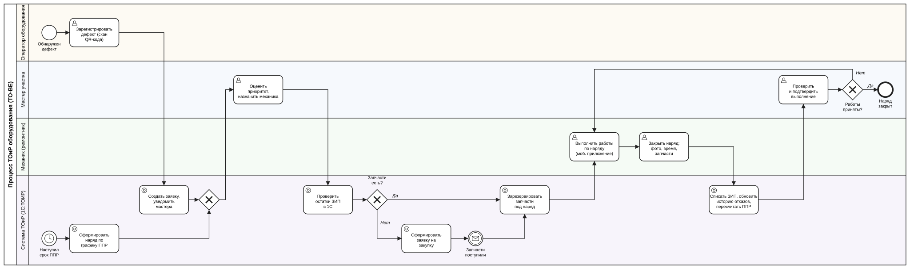

# Концепция информационной системы «Техническое обслуживание и ремонт оборудования на производстве»

**Дисциплина:** Проектирование информационных систем
**Практическая работа:** Разработка концепции ИС (стадия 2 по ГОСТ Р 59793-2021)
**Вариант:** №16 — Техническое обслуживание и ремонт оборудования на производстве
**Группа:** К3339  **Дата:** 26.10.2026

## Состав команды и распределение ролей

| Участник (ФИО) | Роль на стадии концепции | Разделы отчёта |
|---|---|---|
| Андреевский Иван Вячеславович | Руководитель проекта | 3, 6, дорожная карта, выводы |
| Абулашвили Рамзес Тристанович | Бизнес-/системный аналитик | 1, 4, 5 (модель TO-BE) |
| Андреевский Иван Вячеславович | Архитектор | 2, 3 (архитектура вариантов), 8 |
| Абулашвили Рамзес Тристанович | Специалист по ИБ | 7 (реестр рисков), требования 152-ФЗ |
| Шебардин Богдан Алексеевич | Представитель пользователей / «заказчик» | согласование критериев и весов, проверка TO-BE |

## Исходные условия «заказчика» (допущения)

Конкретные ограничения преподавателем не заданы, поэтому команда приняла следующие условные значения. Все расчёты ниже опираются на них.

| Параметр | Значение |
|---|---|
| Объект | Условный машиностроительный завод ООО «Механика», 3 цеха |
| Парк оборудования | 120 единиц (станки с ЧПУ, прессы, компрессоры, кран-балки) |
| Ремонтная служба | главный инженер, главный механик, 4 мастера, 15 механиков и электриков, кладовщик ЗИП |
| Число пользователей ИС | до 40 рабочих мест + до 60 операторов оборудования (только регистрация дефектов) |
| Бюджет на создание | не более 3,0 млн руб. |
| Срок ввода | не более 6 месяцев |
| Размещение данных | только на территории РФ (собственный сервер или российское облако) |
| Учётная система | 1С:Управление производственным предприятием (склад, бухгалтерия) |
| Стоимость часа простоя основного оборудования | 8 тыс. руб. (недовыпуск продукции) |
| Стоимость часа работы ремонтного персонала | 600 руб. с учётом страховых взносов |

---

## 1. Характеристика объекта автоматизации и требования пользователя

### 1.1. Объект автоматизации

Объект автоматизации — процесс технического обслуживания и ремонта (ТОиР) производственного оборудования: планово-предупредительные ремонты (ППР), устранение отказов, учёт запасных частей и анализ надёжности оборудования.

**Участники процесса:** оператор оборудования (обнаруживает дефект), мастер участка (оценивает, назначает исполнителя, принимает работу), механик/электрик (выполняет работы), главный механик (планирует ППР, анализирует отказы), главный инженер (утверждает бюджет ремонтов, контролирует показатели), кладовщик ЗИП (выдаёт и списывает запчасти).

### 1.2. Текущий процесс (AS-IS) и проблемы

Сейчас график ППР ведётся главным механиком в Excel, наряды выписываются на бумаге, о дефектах сообщают устно или по телефону, запчасти списываются в 1С задним числом по бумажным требованиям.

| № | Проблема AS-IS | Последствие |
|---|---|---|
| П1 | График ППР в Excel не связан с фактическими нарядами, плановые работы пропускаются | Аварийные отказы, около 600 ч незапланированного простоя в год |
| П2 | Дефекты сообщаются устно, заявки теряются, нет фиксации времени | Невозможно контролировать сроки реакции |
| П3 | Механик не знает заранее, есть ли нужная запчасть на складе | Повторные походы на склад, простои в ожидании ЗИП, срочные закупки по завышенным ценам |
| П4 | История ремонтов разбросана по бумажным журналам | Нельзя рассчитать наработку на отказ (MTBF) и время ремонта (MTTR), выявить «проблемное» оборудование |
| П5 | Бумажные наряды заполняются неполно и с опозданием | Нет данных о трудозатратах, ошибки в списании ЗИП |
| П6 | Руководство не видит состояние парка в целом | Бюджет ремонтов планируется «по прошлому году» |

### 1.3. Требования пользователя

Приоритет по методу MoSCoW: **Must** — обязательные, **Should** — желательные, **Could** — возможное расширение. Варианты, не выполняющие хотя бы одно Must-требование, исключаются из выбора.

**Функциональные требования**

| Код | Требование | Приоритет | Устраняет |
|---|---|---|---|
| Ф1 | Реестр оборудования с иерархией (цех → линия → агрегат) и паспортом единицы | Must | П4, П6 |
| Ф2 | График ППР с автоматическим формированием нарядов по сроку или наработке | Must | П1 |
| Ф3 | Регистрация дефекта с мобильного устройства в цехе (по QR-коду оборудования) | Must | П2 |
| Ф4 | Электронный наряд: назначение исполнителя, статусы, отметка времени и использованных ЗИП | Must | П2, П5 |
| Ф5 | Проверка и резервирование запчастей по остаткам склада 1С | Must | П3 |
| Ф6 | История отказов и отчёты: MTBF, MTTR, выполнение графика ППР, затраты по оборудованию | Must | П4, П6 |
| Ф7 | Уведомления мастеру и механику о новых заявках и просрочках | Should | П2 |
| Ф8 | Дашборд главного инженера с ключевыми показателями | Should | П6 |
| Ф9 | Работа мобильного клиента без связи (офлайн) с последующей синхронизацией | Should | П5 |
| Ф10 | Сбор показаний счётчиков наработки и датчиков (IIoT) | Could | П1 |

**Нефункциональные требования и ограничения**

| Код | Требование | Приоритет |
|---|---|---|
| Н1 | Двусторонняя интеграция со складским учётом 1С:УПП | Must |
| Н2 | Хранение данных на территории РФ | Must |
| Н3 | Разграничение прав по ролям, журнал действий пользователей | Must |
| Н4 | Время отклика интерфейса не более 2 с при 40 одновременных пользователях | Should |
| Н5 | Соответствие 152-ФЗ при обработке персональных данных сотрудников | Must |
| О1 | Бюджет на создание не более 3,0 млн руб. | Must |
| О2 | Срок ввода не более 6 месяцев | Must |

---

## 2. Аналитический обзор аналогов и готовых решений

Рынок систем класса CMMS/EAM (управление техническим обслуживанием и активами) в России представлен как тяжёлыми корпоративными решениями, так и облачными сервисами для среднего бизнеса. Иностранные лидеры (IBM Maximo, SAP PM) для нашего заказчика не рассматриваются из-за ограничений доступа и требования о размещении данных в РФ.

| Решение | Разработчик | Класс и размещение | Ключевые функции | Интеграция | Лицензирование и стоимость |
|---|---|---|---|---|---|
| **1С:ТОИР Управление ремонтами и обслуживанием оборудования КОРП** | «Деснол Софт» / фирма «1С», Россия | CMMS/EAM на платформе 1С, свой сервер | Реестр объектов ремонта, ППР, наряды, учёт дефектов, ЗИП, анализ надёжности; мобильное приложение «Мобильная бригада» (NFC, штрихкоды, фото) | Штатный обмен с 1С:ERP, 1С:УПП, 1С:ЗУП, 1С:ДО, АСУ ТП | Бессрочная лицензия, от 35,9 тыс. руб. за базовую поставку + клиентские лицензии + внедрение |
| **TRIM** | НПП «СпецТек», Санкт-Петербург | EAM, свой сервер или частное облако; Linux/Windows, Docker, веб-интерфейс | Данные об активах, планирование и выполнение ТОиР, дефекты, обходы, затраты, ЗИП, RCM | Открытый API | Цена по запросу; ориентирован на крупные предприятия |
| **робоТОиР** | «Флоуком Облачные решения», Россия | Облачная CMMS (SaaS) | Реестр оборудования, наряды, ППР, мобильное приложение | Ограниченная, через выгрузки и API | Подписка, цена по запросу |
| **CloudRepairs** | Smartom, Россия | Облачная платформа FSM + CMMS | Превентивное планирование, загрузка персонала, сопровождение выездных работников, мобильное приложение | API | Подписка, цена по запросу |
| **Atlas CMMS** | Intelloop (зарубежный разработчик) | Open source (GPLv3), облако или свой сервер | Планирование работ, учёт оборудования и запчастей, контроль выполнения | API и вебхуки | Самостоятельное размещение бесплатно; облачные тарифы от $10–15 за пользователя в месяц |

**Выводы по обзору:**

1. Единственное решение со штатной интеграцией с 1С:УПП «из коробки» — 1С:ТОИР КОРП. Для остальных интеграцию со складом придётся дорабатывать.
2. TRIM функционально наиболее мощный, но избыточен и дорог для парка из 120 единиц.
3. Облачные отечественные сервисы (робоТОиР, CloudRepairs) быстро запускаются, но слабее интегрируются с 1С и создают зависимость от тарифов поставщика.
4. Atlas CMMS дешёв и открыт, но это зарубежный продукт без русскоязычной поддержки; при самостоятельном размещении требует ресурсов на доработку. Может служить основой собственной разработки.

---

## 3. Альтернативные варианты концепции ИС

Рассмотрены четыре содержательно различных варианта: нулевой (организационный), доработка экосистемы 1С готовым отраслевым решением, облачный SaaS и собственная разработка.

| Параметр | **A. Организационный** | **B. 1С:ТОИР КОРП (готовое решение)** | **C. Облачная CMMS (SaaS)** | **D. Собственная разработка** |
|---|---|---|---|---|
| Идея решения | Регламент ППР, шаблоны нарядов, общая таблица учёта в МойОфис / Р7-Офис на сервере завода | Внедрение отраслевой конфигурации 1С на сервере завода, рядом с 1С:УПП, плюс мобильное приложение | Подписка на отечественный облачный сервис (робоТОиР или аналог) с настройкой под завод | Веб-приложение + мобильный PWA-клиент, разработанные под процессы завода |
| Автоматизируемые функции | Ф1, Ф2 частично (таблица), остальное вручную | Ф1–Ф9, Ф10 через модуль АСУ ТП | Ф1–Ф4, Ф6–Ф9; Ф5 через выгрузку остатков | Ф1–Ф9; Ф10 закладывается в архитектуру |
| Архитектура и технологии | Файловый сервер, офисный пакет | Платформа 1С:Предприятие 8.3, СУБД PostgreSQL, сервер завода; обмен с 1С:УПП штатными средствами | Мультиарендная SaaS в российском ЦОД, мобильное приложение поставщика; обмен с 1С выгрузкой файлов | Микросервисы на Python/Go, PostgreSQL, REST API, обмен с 1С через HTTP-сервисы; сервер завода |
| Команда и трудоёмкость | Главный механик + аналитик, 1 чел.-мес. | Партнёр-внедренец (РП, консультант, программист 1С) + ключевые пользователи, ≈10 чел.-мес. | Аналитик + администратор + поставщик, ≈3 чел.-мес. | Аналитик, 2 разработчика, тестировщик, ≈18 чел.-мес. |
| Стоимость создания, тыс. руб. | 150 | 2 350 | 700 | 2 900 |
| Эксплуатация в год, тыс. руб. | 120 | 420 | 510 | 670 |
| Срок ввода, мес. | 1 | 5 | 2 | 6 |
| Достоинства | Почти бесплатно, быстро, нет новых систем | Готовая отраслевая методология, штатная интеграция с 1С, данные на своём сервере, есть специалисты 1С на рынке | Самый быстрый запуск, нет затрат на инфраструктуру, обновления от поставщика | Полное соответствие процессам, нет лицензий, независимость от поставщика |
| Недостатки | Не решает П2, П3, П5; ручной ввод; нет мобильного доступа; данные быстро устаревают | Высокие затраты на внедрение и НСИ; интерфейс 1С менее удобен в цеху без мобильного клиента | Слабая интеграция со складом 1С; зависимость от тарифов и доступности сервиса; данные у третьей стороны | Самый дорогой и долгий; бюджет и срок у верхней границы; риски качества и сопровождения |

**Расшифровка стоимости (допущения):**

Цены лицензий 1С:ТОИР — по прайсу на Инфостарте [6]; подписка облачной CMMS и тарифы Atlas CMMS — по открытым карточкам продуктов [11, 12]. Стоимость работ (150 тыс. руб. за чел.-мес. с учётом страховых взносов и накладных расходов, ставка сопровождения) — **допущение команды**; на стадии ТЗ она заменяется данными коммерческих предложений.

- **B:** лицензии 1С:ТОИР КОРП и клиентские лицензии на 40 мест — 650; сервер и СУБД — 250; услуги внедрения (обследование, паспортизация 120 единиц, настройка ППР, интеграция с 1С:УПП, обучение) — 1 450. Эксплуатация: обновления и ИТС — 120, сопровождение программистом 1С (0,25 ставки) — 240, инфраструктура — 60.
- **C:** настройка, загрузка НСИ — 450; 8 защищённых планшетов для цехов — 250. Эксплуатация: подписка ≈750 руб. за пользователя в месяц × 40 — 360, администрирование — 150.
- **D:** 18 чел.-мес. × 150 тыс. руб. ≈ 2 700; сервер и планшеты — 200. Эксплуатация: поддержка (0,5 ставки разработчика) — 540, инфраструктура — 130.
- **A:** разработка регламента и шаблонов, обучение — 150; поддержание таблиц в актуальном состоянии — 120 в год.

---

## 4. Сравнение вариантов и обоснование выбора

### 4.1. Матрица соответствия «требование × вариант»

| Требование | Приоритет | A | B | C | D |
|---|:-:|:-:|:-:|:-:|:-:|
| Ф1 Реестр оборудования | Must | ◐ | ✓ | ✓ | ✓ |
| Ф2 Автоформирование нарядов ППР | Must | ✗ | ✓ | ✓ | ✓ |
| Ф3 Регистрация дефекта с мобильного | Must | ✗ | ✓ | ✓ | ✓ |
| Ф4 Электронный наряд | Must | ✗ | ✓ | ✓ | ✓ |
| Ф5 Остатки и резерв ЗИП из 1С | Must | ✗ | ✓ | ◐ | ✓ |
| Ф6 MTBF, MTTR, отчёты | Must | ◐ | ✓ | ✓ | ✓ |
| Н1 Интеграция с 1С:УПП | Must | ✗ | ✓ | ◐ | ✓ |
| Н2 Данные в РФ | Must | ✓ | ✓ | ✓ | ✓ |
| Н3 Роли и журнал действий | Must | ✗ | ✓ | ✓ | ✓ |
| Н5 152-ФЗ | Must | ◐ | ✓ | ◐ | ✓ |
| О1 Бюджет ≤ 3,0 млн руб. | Must | ✓ | ✓ | ✓ | ◐** |
| О2 Срок ≤ 6 мес. | Must | ✓ | ✓ | ✓ | ✓ (на пределе) |
| **Итог по Must** | | **не проходит** | **проходит** | **условно\*** | **условно\*\*** |
| Ф7 Уведомления о заявках и просрочках | Should | ✗ | ✓ | ✓ | ✓ |
| Ф8 Дашборд главного инженера | Should | ✗ | ✓ | ✓ | ✓ |
| Ф9 Офлайн-режим мобильного клиента | Should | ✗ | ✓ | ✓ | ✓ |
| Н4 Отклик ≤ 2 с при 40 пользователях | Should | — | ✓ | ✓ | ✓ |
| Ф10 Счётчики наработки и датчики (IIoT) | Could | ✗ | ✓ | ✗ | ◐ |
| **Выполнено полностью (из 17)** | | **3** | **17** | **13** | **15** |

✓ — выполняется, ◐ — частично, ✗ — не выполняется, — — неприменимо.
\* У варианта C интеграция со складом возможна только выгрузкой файлов, без резервирования в реальном времени; вариант оставлен в сравнении при условии регламентной синхронизации раз в смену.
\*\* Стоимость создания варианта D (2 900 тыс. руб.) формально укладывается в бюджет, но с обязательным резервом 15% (риск №6) составит ≈3 335 тыс. руб. и превысит ограничение О1. Вариант оставлен в сравнении при условии сокращения объёма первой очереди.
Вариант A не выполняет Must-требования и сохраняется в таблице только как базовая точка сравнения («нулевой» вариант).

### 4.2. Критерии, веса и взвешенная оценка

Критерии и веса согласованы с «заказчиком» (Шебардин Б. А.) **до** выставления оценок. Наибольший вес (0,25) получило «Покрытие требований», поскольку цель проекта — устранить проблемы П1–П6; вес «Интеграции с 1С» (0,15) повышен, так как без неё не решается проблема П3 и сохраняется двойной ввод. Оценки — по шкале 1–5, где 5 — лучшее значение (для стоимости и срока 5 — самый дешёвый/быстрый).

| Критерий | Вес $w_j$ | A | B | C | D |
|---|:-:|:-:|:-:|:-:|:-:|
| Покрытие требований пользователя | 0,25 | 1 | 5 | 4 | 4 |
| Стоимость владения за 3 года | 0,20 | 5 | 3 | 4 | 2 |
| Срок ввода | 0,10 | 5 | 3 | 5 | 2 |
| Интеграция с 1С:УПП | 0,15 | 1 | 5 | 2 | 4 |
| Безопасность, 152-ФЗ | 0,10 | 3 | 5 | 3 | 4 |
| Масштабируемость (датчики, новые цеха) | 0,10 | 1 | 4 | 3 | 5 |
| Независимость от поставщика | 0,10 | 5 | 3 | 2 | 5 |
| **Итог $S_i$** | **1,00** | **2,80** | **4,10** | **3,40** | **3,60** |

$S_i = \sum_j w_j \cdot s_{ij}$

Расчёт для варианта B: 0,25·5 + 0,20·3 + 0,10·3 + 0,15·5 + 0,10·5 + 0,10·4 + 0,10·3 = 1,25 + 0,60 + 0,30 + 0,75 + 0,50 + 0,40 + 0,30 = **4,10**.

### 4.3. Проверка устойчивости

| Изменение весов | A | B | C | D | Лидер |
|---|:-:|:-:|:-:|:-:|:-:|
| Базовый вариант | 2,80 | 4,10 | 3,40 | 3,60 | B |
| «Покрытие» 0,20, «Стоимость» 0,25 | 3,00 | 4,00 | 3,40 | 3,50 | B |
| «Покрытие» 0,30, «Стоимость» 0,15 | 2,60 | 4,20 | 3,40 | 3,70 | B |
| «Покрытие» 0,20, «Срок» 0,15 | 3,00 | 4,00 | 3,45 | 3,50 | B |
| «Покрытие» 0,30, «Интеграция» 0,10 | 2,80 | 4,10 | 3,50 | 3,60 | B |
| Стресс-тест: «Стоимость» 0,40 за счёт «Покрытия» (0,05) | 3,60 | 3,70 | 3,40 | 3,20 | B |

При изменении веса самого значимого критерия на ±0,05 лидер не меняется: отрыв B от ближайшего варианта D составляет 0,5 балла. Даже при удвоении веса стоимости B остаётся первым. **Выбор устойчив.**

### 4.4. Вывод

Выбран **вариант B — внедрение 1С:ТОИР КОРП с мобильным приложением**. Он единственный полностью закрывает обязательные требования без доработок, использует уже существующую у завода экосистему 1С и укладывается в бюджет и срок с запасом. Вариант D — резервный: к нему стоит вернуться, если на этапе закупки выяснится, что стоимость лицензий и внедрения выше 3,0 млн руб.

---

## 5. Описание выбранной концепции и модель процессов TO-BE

### 5.1. Архитектура выбранного варианта

- **Серверная часть:** 1С:ТОИР КОРП на платформе 1С:Предприятие 8.3, СУБД PostgreSQL, сервер в серверной завода (данные не покидают предприятие).
- **Клиенты:** тонкий клиент 1С и веб-клиент для мастеров, главного механика и главного инженера; мобильное приложение «Мобильная бригада» на защищённых планшетах для механиков и общих планшетах в цехах для операторов.
- **Интеграция:** обмен с 1С:УПП (справочник номенклатуры ЗИП, остатки, резервирование, списание, требования-накладные) — каждые 15 минут и по событию.
- **Маркировка:** QR-коды на каждой единице оборудования — для быстрой регистрации дефектов и подтверждения присутствия механика на объекте.
- **Расширение (Could):** подключение счётчиков наработки и датчиков через модуль интеграции с АСУ ТП на втором этапе.

### 5.2. Модель TO-BE (BPMN 2.0)



*Исходный файл диаграммы для Camunda Modeler / draw.io / bpmn.io: [`bpmn/to-be.bpmn`](bpmn/to-be.bpmn).*

Процесс запускается двумя событиями: наступлением срока ППР (таймер, наряд формирует система) или обнаружением дефекта оператором. Оба потока сходятся у мастера, который назначает исполнителя. Далее система проверяет остатки ЗИП в 1С и либо резервирует запчасти, либо формирует заявку на закупку. Механик выполняет и закрывает наряд в мобильном приложении, система списывает ЗИП и обновляет историю отказов, мастер принимает работу или возвращает её на доработку.

### 5.3. Какие проблемы AS-IS устраняются

| Проблема | Изменение в TO-BE | За счёт чего |
|---|---|---|
| П1 Пропуск ППР | Наряды по ППР формируются автоматически, просрочки видны мастеру | Таймерное событие и график ППР в системе |
| П2 Потеря заявок | Каждый дефект регистрируется с отметкой времени и фото | Мобильная регистрация по QR-коду, уведомление мастера |
| П3 Нет информации о ЗИП | Наличие проверяется до выдачи наряда, запчасти резервируются | Интеграция с остатками 1С:УПП |
| П4 Нет истории | История отказов и затрат копится автоматически | Закрытие наряда с отметкой работ, времени и ЗИП |
| П5 Неполные бумажные наряды | Наряд не закрывается без обязательных полей | Электронный наряд в мобильном приложении |
| П6 Нет картины по парку | Отчёты MTBF, MTTR, выполнение ППР, затраты | Аналитика 1С:ТОИР, дашборд главного инженера |

### 5.4. Границы системы

| Автоматизируется | Остаётся ручным |
|---|---|
| Формирование нарядов по ППР, регистрация и маршрутизация заявок | Оценка приоритета дефекта и выбор исполнителя мастером |
| Проверка остатков, резервирование и списание ЗИП | Физическая выдача запчастей кладовщиком |
| Учёт времени, фото, история отказов, расчёт показателей | Выполнение ремонта, приёмка качества мастером |
| Формирование заявки на закупку | Согласование и проведение закупки (в 1С:УПП, вне границ ИС ТОиР) |

---

## 6. Ожидаемые эффекты и технико-экономическое обоснование

### 6.1. Исходные допущения для расчёта эффекта

| Статья потерь AS-IS | Расчёт | Потери в год, тыс. руб. |
|---|---|---|
| Незапланированный простой | 600 ч × 8 тыс. руб. | 4 800 |
| Непроизводительное время персонала (поиск информации, бумажные наряды, походы на склад) | 15 чел. × 1 ч/день × 247 дн. × 0,6 тыс. руб. | 2 223 |
| Переплата при срочных закупках ЗИП | 1 500 тыс. руб. срочных закупок × 20% наценки | 300 |

Объём простоя (600 ч), доля непроизводительного времени (1 ч в день) и объём срочных закупок — допущения команды для условного завода (см. «Исходные условия»). Ожидаемое снижение потерь по вариантам — **экспертная оценка команды** исходя из того, какие проблемы AS-IS закрывает каждый вариант (раздел 4.1); фактические значения уточняются по результатам опытной эксплуатации:

| Статья | A | B | C | D |
|---|:-:|:-:|:-:|:-:|
| Простой | 5% | 25% | 20% | 25% |
| Время персонала | 15% | 40% | 25% | 40% |
| Срочные закупки | 10% | 50% | 20% | 50% |

### 6.2. Расчёт показателей (горизонт 3 года)

- $TCO = C_{созд} + \sum_{t=1}^{3} C_{экспл,t}$
- Эффект за 3 года учитывает, что в первый год система работает только $(12 - \text{срок ввода})$ месяцев.
- $T_{ок} = C_{созд} / (E - C_{экспл})$
- $ROI = (\sum_t E_t - TCO) / TCO \cdot 100\%$

| Показатель, тыс. руб. | A | **B** | C | D |
|---|--:|--:|--:|--:|
| Стоимость создания $C_{созд}$ | 150 | **2 350** | 700 | 2 900 |
| Эксплуатация в год $C_{экспл}$ | 120 | **420** | 510 | 670 |
| TCO за 3 года | 510 | **3 610** | 2 230 | 4 910 |
| Годовой эффект $E$ | 603 | **2 239** | 1 576 | 2 239 |
| Эффект за 3 года | 1 760 | **5 785** | 4 465 | 5 598 |
| Чистый эффект за 3 года | 1 250 | **2 175** | 2 235 | 688 |
| Срок окупаемости $T_{ок}$, лет | 0,3 | **1,3** | 0,7 | 1,9 |
| ROI за 3 года | 245% | **60%** | 100% | 14% |

Расчёт годового эффекта для B: 4 800 × 0,25 + 2 223 × 0,40 + 300 × 0,50 = 1 200 + 889 + 150 = **2 239 тыс. руб.**
Окупаемость B: 2 350 / (2 239 − 420) = **1,29 года**.

**Интерпретация.** Вариант A даёт самый высокий ROI за счёт почти нулевых вложений, но абсолютный эффект мал, а Must-требования не выполняются. Вариант C близок к B по чистому эффекту, но не обеспечивает интеграцию со складом, от которой зависит эффект по П3; при этом его годовые расходы выше и растут вместе с тарифами поставщика. Вариант B окупается за 1,3 года и даёт наибольший абсолютный эффект среди вариантов, прошедших проверку Must-требований. Вариант D дороже B на 1,3 млн руб. по TCO при том же эффекте.

### 6.3. Неденежные эффекты и KPI

| Эффект | KPI | Сейчас (оценка) | Цель через 12 мес. | Способ измерения |
|---|---|:-:|:-:|---|
| Переход от аварийных к плановым ремонтам | Доля плановых работ в общем объёме | ≈40% | ≥ 70% | Отчёт по нарядам в 1С:ТОИР |
| Дисциплина ППР | Выполнение графика ППР в срок | не измеряется | ≥ 90% | Отчёт «План-факт ППР» |
| Надёжность оборудования | Средняя наработка на отказ (MTBF) | база — первые 3 мес. | +15% к базе | Аналитика отказов |
| Скорость ремонта | Среднее время восстановления (MTTR) | база — первые 3 мес. | −20% к базе | Время от регистрации до закрытия наряда |
| Скорость реакции | Время от регистрации дефекта до назначения механика | не измеряется | ≤ 30 мин | Журнал статусов наряда |

---

## 7. Реестр рисков и меры реагирования

Уровень риска $R = P \cdot I$; высокий — 15–25, средний — 8–14, низкий — 1–7. Риски ранжированы по убыванию $R$.

| № | Риск | Категория | P | I | R | Уровень | Стратегия | Меры | Ответственный |
|---|---|---|:-:|:-:|:-:|---|---|---|---|
| 1 | Неполные и недостоверные данные о парке (паспорта, нормативы ППР) | Организационный | 4 | 4 | 16 | Высокий | Снизить | Паспортизация и инвентаризация оборудования до запуска; шаблоны нормативов ППР от поставщика | Главный механик |
| 2 | Сопротивление механиков и мастеров, низкая дисциплина ввода данных | Организационный | 4 | 4 | 16 | Высокий | Снизить | Пилот в одном цехе, обучение, ключевые пользователи; включение KPI ППР в систему премирования | Руководитель проекта |
| 3 | Сложности интеграции с 1С:УПП из-за доработанной конфигурации | Технический | 3 | 4 | 12 | Средний | Снизить | Аудит конфигурации до заключения договора; интеграция в отдельном этапе с фиксированной ценой | Архитектор |
| 4 | Сбой сервера и потеря истории ремонтов | Технический | 2 | 5 | 10 | Средний | Снизить | Ежедневное резервное копирование, копия на отдельном носителе, проверка восстановления раз в квартал | Специалист по ИБ |
| 5 | Отсутствие устойчивой связи Wi-Fi в цехах | Технический | 3 | 3 | 9 | Средний | Снизить | Обследование покрытия; офлайн-режим мобильного приложения; дополнительные точки доступа | Архитектор |
| 6 | Превышение бюджета внедрения | Финансовый | 3 | 3 | 9 | Средний | Снизить | Поэтапная оплата, резерв 15%, приоритизация функций | Руководитель проекта |
| 7 | Затягивание закупки лицензий и услуг партнёра | Организационный | 3 | 3 | 9 | Средний | Снизить | Подготовка документации на закупку параллельно с ТЗ; заранее согласованный список поставщиков | Руководитель проекта |
| 8 | Несанкционированный доступ к данным (в т. ч. с утерянного планшета) | Информационная безопасность | 2 | 4 | 8 | Средний | Снизить | Ролевой доступ, журнал действий, VPN для мобильных устройств, удалённая блокировка планшетов | Специалист по ИБ |
| 9 | Нарушение 152-ФЗ при обработке персональных данных сотрудников (ФИО, табельные номера, геолокация) | Правовой | 2 | 4 | 8 | Средний | Снизить | Локальный акт об обработке ПДн, согласия сотрудников на геометки, актуализация уведомления в Роскомнадзор | Специалист по ИБ |
| 10 | Зависимость от партнёра-внедренца, уход ключевого специалиста 1С | Организационный | 2 | 4 | 8 | Средний | Передать / снизить | Договор сопровождения с SLA, передача документации, обучение собственного администратора | Руководитель проекта |

Два высоких риска (№1 и №2) — организационные, а не технические: успех ИС ТОиР в первую очередь зависит от качества исходных данных и вовлечённости ремонтного персонала. Поэтому в дорожную карту отдельно включены паспортизация и пилотный цех.

---

## 8. Порядок оценки качества и условия приёмки

### 8.1. Показатели качества

| № | Показатель | Целевое значение | Способ проверки |
|---|---|---|---|
| 1 | Время регистрации дефекта с мобильного устройства (от скана QR до отправки) | ≤ 1 мин | Хронометраж 20 регистраций разными операторами |
| 2 | Автоматическое формирование нарядов ППР | 100% плановых работ месяца | Сверка нарядов с утверждённым графиком ППР |
| 3 | Синхронизация остатков ЗИП с 1С:УПП | задержка ≤ 15 мин; 0 расхождений в выборке из 50 позиций | Контрольная выборка, сравнение остатков в двух системах |
| 4 | Время отклика интерфейса | ≤ 2 с при 40 одновременных пользователях | Нагрузочное тестирование |
| 5 | Доступность системы в рабочие смены | ≥ 99% за месяц опытной эксплуатации | Журнал мониторинга сервера |
| 6 | Полнота паспортизации | 100% из 120 единиц, у каждой — QR-код и норматив ППР | Выгрузка реестра оборудования |
| 7 | Доля нарядов, закрытых в системе с отметкой времени и ЗИП | ≥ 95% через 3 мес. эксплуатации | Отчёт по нарядам |

### 8.2. Порядок приёмки

Испытания проводятся по ГОСТ 34.603-1992 «Виды испытаний автоматизированных систем».

| Вид испытаний | Содержание | Участники | Итоговый документ |
|---|---|---|---|
| Предварительные автономные | Проверка функций Ф1–Ф9 и интеграции с 1С на тестовой базе | Партнёр-внедренец, аналитик | Протокол автономных испытаний |
| Предварительные комплексные | Сквозной процесс TO-BE на данных пилотного цеха, показатели 1–4 | Партнёр, ключевые пользователи, специалист по ИБ | Протокол комплексных испытаний, акт о приёмке в опытную эксплуатацию |
| Опытная эксплуатация (1 мес.) | Работа всех трёх цехов, сбор показателей 5–7 | Мастера, механики, главный механик | Журнал опытной эксплуатации, акт о завершении опытной эксплуатации |
| Приёмочные | Проверка всех 7 показателей комиссией | Приёмочная комиссия под председательством главного инженера | Протокол приёмочных испытаний, акт приёмки в постоянную эксплуатацию |

Показатели раздела 8.1 переходят в техническое задание (раздел «Требования к системе» по ГОСТ 34.602-2020) на следующей практической работе.

### 8.3. Дорожная карта реализации

| Месяц | Работы | Результат |
|---|---|---|
| 1 | Разработка ТЗ, аудит конфигурации 1С:УПП, закупка лицензий и услуг | ТЗ, договор с партнёром |
| 2 | Установка сервера и платформы, паспортизация оборудования, маркировка QR-кодами | Реестр 120 единиц |
| 3 | Настройка графиков ППР, ролей и прав, интеграция с 1С:УПП | Работающая интеграция на тестовой базе |
| 4 | Пилот в цехе №1, обучение пользователей, предварительные испытания | Акт о приёмке в опытную эксплуатацию |
| 5 | Тиражирование на цеха №2 и №3, опытная эксплуатация | Акт о завершении опытной эксплуатации |
| 6 (резерв) | Устранение замечаний, приёмочные испытания | Акт приёмки в постоянную эксплуатацию |

---

## 9. Выводы

1. Объект автоматизации — процесс ТОиР на заводе со 120 единицами оборудования. Выявлено 6 проблем AS-IS, сформулировано 10 функциональных и 7 нефункциональных требований, из них 12 обязательных.
2. Проведён обзор 5 аналогов: 1С:ТОИР КОРП, TRIM, робоТОиР, CloudRepairs, Atlas CMMS. Штатная интеграция с 1С:УПП есть только у 1С:ТОИР.
3. Разработаны 4 варианта: организационный (A), 1С:ТОИР КОРП (B), облачная CMMS (C) и собственная разработка (D). Вариант A не выполняет обязательные требования; варианты C (интеграция со складом) и D (бюджет с учётом резерва) выполняют их лишь условно. Полностью все 17 требований закрывает только вариант B.
4. По методу взвешенных оценок выбран вариант **B** (4,10 балла против 3,60 у D и 3,40 у C). Выбор устойчив к изменению весов на ±0,05 и к удвоению веса стоимости.
5. Для варианта B: TCO за 3 года — 3,61 млн руб., годовой эффект — 2,24 млн руб., срок окупаемости — 1,3 года, ROI за 3 года — 60%.
6. Выявлено 10 рисков; два высоких — организационные (качество данных о парке и вовлечённость персонала), для них предусмотрены паспортизация и пилотный цех.
7. **В техническое задание переходят:** требования раздела 1.3, архитектура раздела 5.1, модель TO-BE, 7 показателей качества и порядок приёмки раздела 8.

---

## Список источников

1. ГОСТ Р 59793-2021. Автоматизированные системы. Стадии создания.
2. ГОСТ 34.602-2020. Техническое задание на создание автоматизированной системы.
3. ГОСТ 34.603-1992. Виды испытаний автоматизированных систем.
4. ГОСТ 34.201-2020. Виды, комплектность и обозначение документов при создании автоматизированных систем.
5. Федеральный закон от 27.07.2006 № 152-ФЗ «О персональных данных».
6. 1С:ТОИР Управление ремонтами и обслуживанием оборудования КОРП — описание и цены. Инфостарт: https://infostart.ru/public/432229/
7. Описание функциональных возможностей 1С:ТОИР КОРП. Фирма «1С»: https://solutions.1c.ru/upload/reestr/8b1/2hlobtafb2yrtxaxytn4y7suqxw1np12/Opisanie-funktsionalnykh-vozmozhnostey-TOIR-KORP.pdf
8. Мобильное приложение «Мобильная бригада» для 1С:ТОИР КОРП. App Store: https://apps.apple.com/pa/app/id6443615418
9. TRIM — карточка продукта. Soware.ru: https://soware.ru/products/trim
10. CloudRepairs — описание приложения. RuStore: https://www.rustore.ru/catalog/app/com.smartom.cloudrepairs
11. робоТОиР — карточка продукта. Soware.ru: https://soware.ru/products/robotoir/faq
12. Atlas CMMS — обзор и тарифы. Toolfox: https://toolfox.ru/services/s/atlas-cmms ; Capterra: https://www.capterra.co.uk/software/1077098/Atlas
13. CMMS-системы для ТОиР — обзор рынка. Toolfox: https://toolfox.ru/services/proizvodstvo-soft/cmms

---

## Приложение А. Структура репозитория

```
kontseptsiya-toir/
├── README.md          — настоящий отчёт
├── img/to-be.svg      — диаграмма TO-BE для просмотра в отчёте
├── img/to-be.png      — то же в растровом виде
└── bpmn/to-be.bpmn    — исходник BPMN 2.0 (открывается в Camunda Modeler, bpmn.io, draw.io)
```
