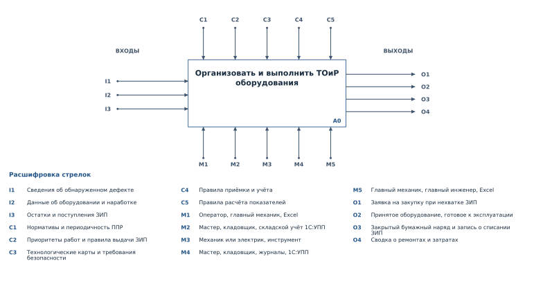
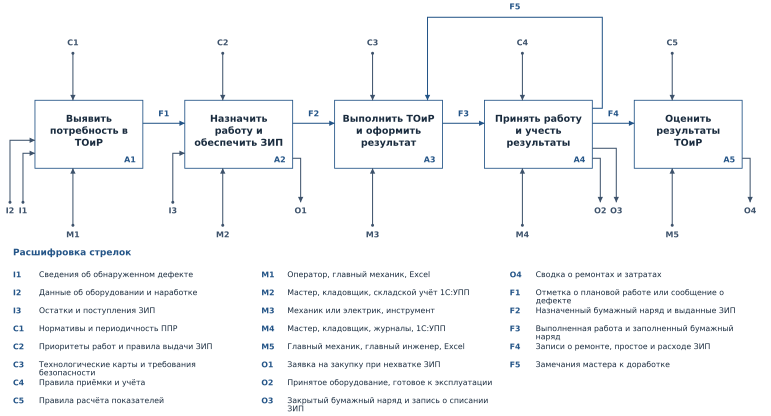
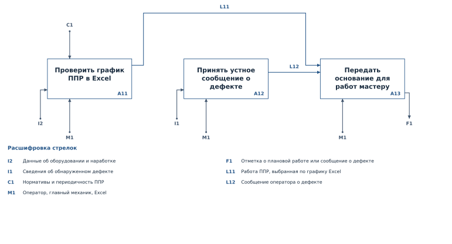
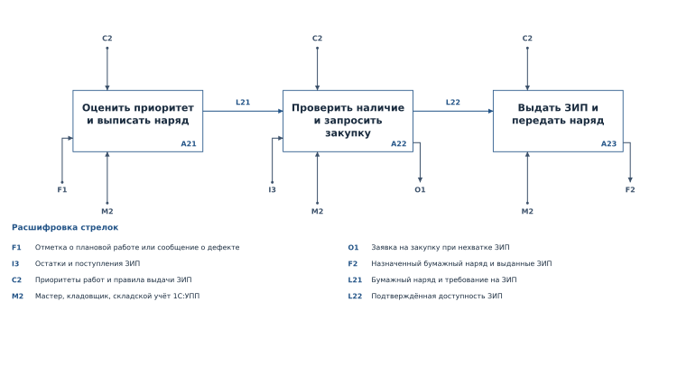
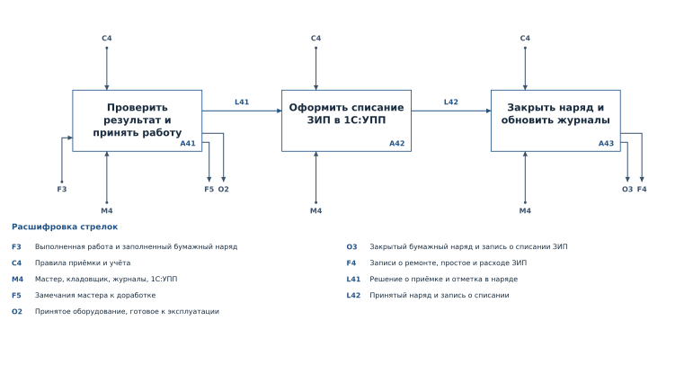
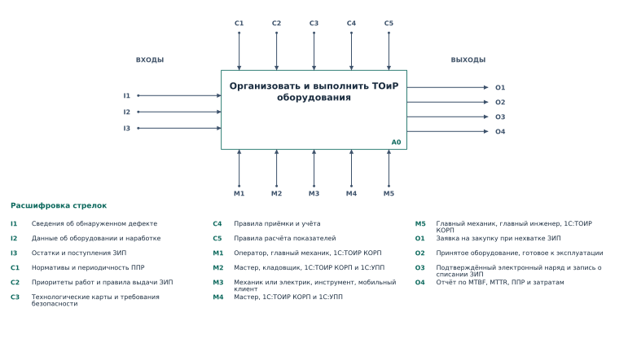
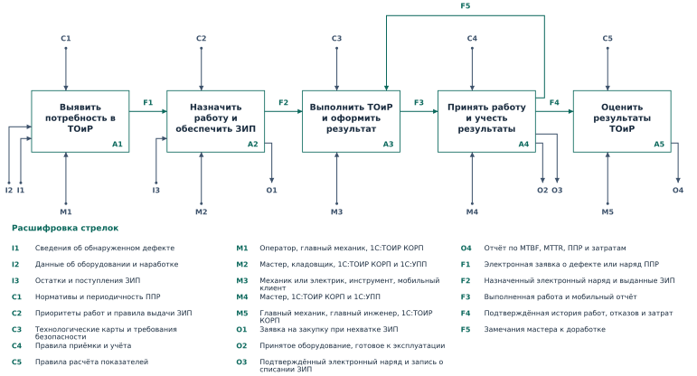
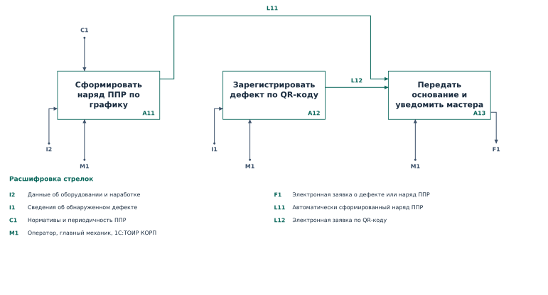
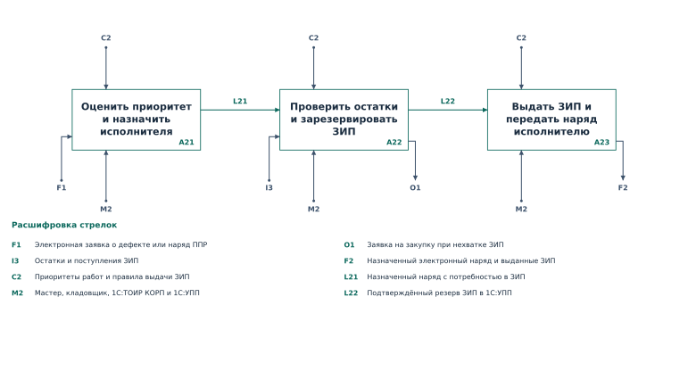
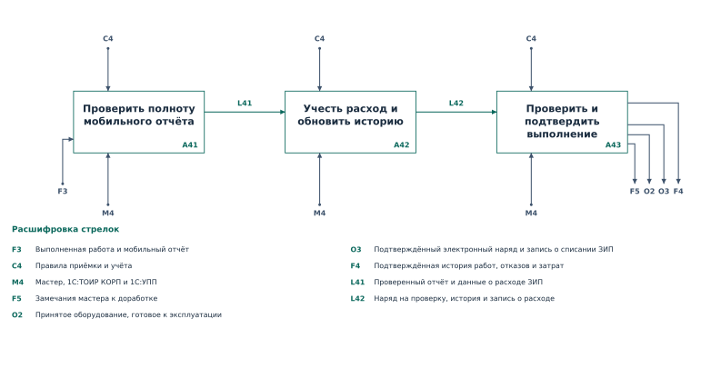

# Модель бизнес-процессов технического обслуживания и ремонта оборудования

**Дисциплина:** Проектирование информационных систем  
**Практическая работа:** № 3 — Разработка модели бизнес-процессов с учётом внедрения ИС  
**Вариант:** № 16 — Техническое обслуживание и ремонт оборудования на производстве  
**Группа:** К3339

## Состав команды

- Андреевский Иван Вячеславович
- Абулашвили Рамзес Тристанович
- Шебардин Богдан Алексеевич

---

## 1. Исходные условия и границы модели

**Цель работы** — определить, как внедрение 1С:ТОИР КОРП изменит процессы технического обслуживания и ремонта (ТОиР) на машиностроительном заводе ООО «Механика».

| Параметр | Значение |
| --- | --- |
| Объект | Три производственных цеха, 120 единиц оборудования |
| Работы | Планово-предупредительные ремонты (ППР) и устранение дефектов |
| Участники | Оператор, мастер, механик или электрик, кладовщик, главный механик и главный инженер |
| Информационные системы | 1С:ТОИР КОРП для управления работами и 1С:УПП для складского учёта |
| Граница процесса | От выявления потребности в ТОиР до приёмки и анализа работ. Проведение закупки находится за границей модели |

**Нотация IDEF0.** Входы (I) входят в блок слева, управления (C) — сверху, механизмы (M) — снизу. Результаты (O) выходят справа. F обозначает связи между блоками первого уровня, L — связи внутри декомпозиции. ЗИП — запасные части, инструмент и принадлежности.

Детали текущего процесса, описанные в работе № 2 укрупнённо, уточнены в модели как проектные допущения.

---

## 2. Модель до внедрения ИС (AS-IS)

### 2.1. Контекстная диаграмма A-0 (нулевой уровень)

Контекст охватывает плановые работы и устранение дефектов в трёх цехах. График ППР ведут в Excel, наряды оформляют на бумаге, а 1С:УПП используют для складского учёта.

### 2.2. Декомпозиция A0 (первый уровень)

Пять функций связывают основание для работ, подготовку наряда и ЗИП, выполнение, приёмку и анализ. Если мастер выявляет недочёты, он передаёт замечания исполнителю на доработку (F5).

### 2.3. A1 — выявить потребность в ТОиР (второй уровень)

Главный механик сверяет график в Excel, оператор сообщает о дефекте устно или по телефону. Это два самостоятельных источника работы для мастера.

### 2.4. A2 — назначить работу и обеспечить ЗИП (второй уровень)

Мастер назначает исполнителя и выписывает бумажный наряд. Кладовщик проверяет наличие ЗИП. При дефиците оформляют заявку на закупку, а выдачу недостающих деталей откладывают до поступления.

### 2.5. A4 — принять работу и учесть результаты (второй уровень)

Мастер принимает работу либо отправляет замечания в A3. Для принятого наряда кладовщик проводит списание в 1С:УПП по бумажным документам. Сведения о работе переносят в журналы.

---

## 3. Модель после внедрения ИС (TO-BE)

### 3.1. Контекстная диаграмма A-0 (нулевой уровень)

1С:ТОИР КОРП связывает заявки, график ППР, наряды и историю работ. 1С:УПП остаётся системой складского учёта. Согласование закупки проходит за границей процесса.

### 3.2. Декомпозиция A0 (первый уровень)

Пять функций сохраняют те же границы, что и в AS-IS. Электронные данные связывают наряд, обеспечение ЗИП, отчёт исполнителя и показатели. При отклонении мастер возвращает работу на доработку (F5).

### 3.3. A1 — выявить потребность в ТОиР (второй уровень)

Система формирует наряд при наступлении срока ППР. Оператор регистрирует дефект по QR-коду, при необходимости добавляя фото. Мастер получает электронное основание для назначения работы.

### 3.4. A2 — назначить работу и обеспечить ЗИП (второй уровень)

Мастер определяет приоритет и исполнителя. ИС проверяет остатки 1С:УПП и резервирует детали. При дефиците ИС формирует заявку на закупку. После поступления детали резервируют и физически выдают.

### 3.5. A4 — принять работу и учесть результаты (второй уровень)

Механик передаёт фото, время и расход ЗИП. ИС проверяет обязательные поля, отражает расход и обновляет историю и график ППР. Мастер подтверждает результат либо возвращает работу в A3. В отчётность передаются подтверждённые данные.

---

## 4. Основные различия

| Участок процесса | AS-IS | TO-BE | Что измерять |
| --- | --- | --- | --- |
| ППР | Главный механик сверяет сроки в Excel и вручную передаёт основание мастеру. | Система формирует наряд по графику, просрочки видны мастеру. | Сверка графика и нарядов, доля выполненных ППР. |
| Дефекты | Оператор сообщает устно или по телефону. Время обращения может остаться неизвестным. | Оператор регистрирует дефект по QR-коду. ИС сохраняет время и уведомляет мастера. | Время от регистрации дефекта до назначения. |
| ЗИП | Наличие выясняют по бумажному требованию, списание проводят позднее. | ИС проверяет остатки и резервирует ЗИП через 1С:УПП. Кладовщик физически выдаёт детали. | Время ожидания ЗИП, расхождения остатков. |
| Наряд и приёмка | Исполнитель заполняет бумажный наряд. Мастер принимает работу или возвращает на доработку. | Мобильный отчёт содержит фото, время и фактический расход. Мастер подтверждает выполнение или возвращает работу. | Доля закрытых нарядов с отметками времени и ЗИП. |
| История и анализ | Данные разнесены по журналам и Excel, показатели собирают вручную. | Подтверждённая история даёт данные для отчётов по MTBF, MTTR, ППР и затратам. | Полнота истории отказов, простой и затраты по оборудованию. |

---

## 5. Вывод

После внедрения 1С:ТОИР КОРП плановые наряды формируются автоматически, дефекты регистрируются по QR-коду, а потребность в ЗИП связана с остатками и резервами в 1С:УПП. Мастер определяет приоритет, назначает исполнителя и принимает работу. По накопленным данным главный механик может отслеживать выполнение ППР, затраты, среднюю наработку между отказами (MTBF) и среднее время восстановления (MTTR).

